🇺🇸 English · [🇧🇷 Português](README.pt-BR.md)

# Deproi

**Simple automatic deployer.** Push to a branch, and your Docker Compose app is rebuilt, migrated, recreated and health-checked **on your own server**. If the new version is not healthy, the previous one comes back by itself.

[](https://github.com/rodrigo-pasini/deproi/actions/workflows/ci.yml)
[](LICENSE)

**See it in a real repository:** [deproi-demo](https://github.com/rodrigo-pasini/deproi-demo) is a small app set up with Deproi — workflows, config, and the pull request the updater opens.

<p align="center"></p>

## In 30 seconds

- **Your server, your containers.** No platform, no agent running on the server, no third-party GitHub Actions. One Python file, standard library only.
- **The workflow carries no deploy logic.** The SSH key can run exactly one command, and that command lives on the server, owned by root. Changing the YAML does not change what runs with privilege.
- **Safe by default.** Fast-forward-only checkout, one deploy at a time, fences between environments, a required health check, automatic rollback, and a machine-readable result.
- **Any stack.** Django, Rails, Laravel, Node, Go, a static site: if it runs in Docker Compose with a health check, it works. Migrations and the rest are hooks.

<p align="center"></p>

## What happens when something breaks

<p align="center"></p>

| Result | Exit | What it means |
|---|---|---|
| ✅ `SUCCESS` | 0 | The new commit is live. |
| ✅ `SUCCESS_PROTECTED_DEFERRED` | 0 | Live; a busy worker stayed on its version and updates next time. |
| ✋ `REFUSED` | 2 | Something was not as expected (dirty checkout, wrong branch, fence…). Nothing was touched. |
| ⚠️ `FAILED_NO_CHANGE` | 3 | Fetch, build or a hook failed before any service was recreated. |
| ↩️ `FAILED_ROLLED_BACK` | 4 | The new version was unhealthy; the previous one is back and healthy. |
| 🚨 `FAILED_ROLLBACK` | 5 | The previous version did not recover either: follow [plan B](docs/operations.md#plan-b-deploy-by-hand). |

## Why it is safe

<p align="center"></p>

A leaked deploy key can trigger a deploy of what is already on the branch, and nothing else: no shell, no arguments, no other branch, no other environment. Details and the full threat model: [security](docs/security.md).

## Set it up

Three places, about 20 minutes per environment. The full guide is in [installation](docs/installation.md).

| Where | What you do |
|---|---|
| 🖥️ **Server** | Clone the project, run `prepare-server.sh`, write `/etc/deproi/<name>.json`, deploy once by hand. |
| 💻 **Your machine** | Run `create-deploy-key.sh`: it creates the key, checks the server's fingerprint, stores the secrets in a GitHub environment, and deletes the key locally. |
| 🐙 **GitHub** | Add the workflow (`render-workflow.sh`), push, watch the first deploy. |

```bash
# 🖥️ on the server
sudo ./prepare-server.sh --name myapp-prod --checkout /srv/myapp-prod
sudo nano /etc/deproi/myapp-prod.json
sudo /usr/local/sbin/deproi-myapp-prod        # first deploy, by hand

# 💻 on your machine
./create-deploy-key.sh --name myapp-prod --host 203.0.113.10 --port 22 \
    --repo acme/myapp --environment production --branch main
scripts/render-workflow.sh deploy --name myapp-prod --branch main --environment production \
    > .github/workflows/deploy-production.yml
```

## What your project needs

1. A **health check** on the web service (Dockerfile `HEALTHCHECK` or compose `healthcheck:`).
2. Built images tagged **`image: <name>:${DEPROI_TAG}`**.
3. A **profile and a suffix** per environment, if the server is shared.
4. A versioned **env file** with `COMPOSE_PROJECT_NAME`.
5. A copy of **`deproi.py`** in the project (`deploy/deproi.py`).

[The project contract](docs/project-contract.md) explains each item. [The example](example/) has them all, and [deproi-demo](https://github.com/rodrigo-pasini/deproi-demo) shows them in a complete repository.

## Configuration in one look

```json
{
  "name": "myapp-prod",
  "checkout": { "path": "/srv/myapp-prod", "owner": "ubuntu", "branch": "main" },
  "compose": { "project": "myapp-prod", "profiles": ["prod"], "service_suffix": "-prod",
               "web_service": "web-prod", "image": "myapp", "env_file": "deploy/prod.compose.env" },
  "url": "https://app.example.com",
  "hooks": { "migrate": [{ "name": "migrate", "command": ["python", "manage.py", "migrate", "--noinput"] }] }
}
```

Every key, default and option: [configuration](docs/configuration.md). Hooks for your stack: [recipes](docs/recipes.md).

## Documentation

| | |
|---|---|
| [How it works](docs/how-it-works.md) | The path, the steps, the outcomes, self-update, design decisions. |
| [Installation](docs/installation.md) | Step by step: server, machine, GitHub. |
| [Project contract](docs/project-contract.md) | What your repository needs. |
| [Configuration](docs/configuration.md) | Every key of `/etc/deproi/<name>.json`. |
| [Recipes](docs/recipes.md) | Django, Rails, Laravel, Prisma, Go, static sites, queue workers. |
| [Integrations](docs/integrations.md) | Better Stack, Cloudflare, webhooks (Slack, Discord). |
| [Operations](docs/operations.md) | Reading a deploy, refusals, logs, plan B, rotating keys, upgrading. |
| [Security](docs/security.md) | Layers, threat model, recommendations. |

## For AI agents

Implementing Deproi in a project with an AI coding agent? Point it at [AGENTS.md](AGENTS.md): it is written for agents, with the rules they must not break and the exact questions to ask you.

## Status

Deproi is extracted from a deployer that runs in production today. It is tested by unit tests on Python 3.10 and 3.12, parity tests against that origin deployer, and an end-to-end test that deploys the example over SSH into a server container. Follow the [changelog](CHANGELOG.md).

## Documentation in two languages

Every document is written in English and has a Brazilian Portuguese twin (`*.pt-BR.md`). CI fails if a twin is missing or out of structure.

## Contributing and license

See [CONTRIBUTING.md](CONTRIBUTING.md) and the [code of conduct](CODE_OF_CONDUCT.md). Security reports: [SECURITY.md](SECURITY.md). Released under the [MIT License](LICENSE).
