[🇺🇸 English](README.md) · 🇧🇷 Português

# Deproi

**Deployer simples automático.** Faça push numa branch, e sua aplicação em Docker Compose é reconstruída, migrada, recriada e conferida **no seu próprio servidor**. Se a versão nova não ficar saudável, a anterior volta sozinha.

[](https://github.com/rodrigo-pasini/deproi/actions/workflows/ci.yml)
[](LICENSE)

**Veja num repositório de verdade:** o [deproi-demo](https://github.com/rodrigo-pasini/deproi-demo) é um app pequeno configurado com o Deproi — workflows, configuração e o pull request que o atualizador abre.

<p align="center"></p>

## Em 30 segundos

- **Seu servidor, seus contêineres.** Sem plataforma, sem agente rodando no servidor, sem GitHub Actions de terceiros. Um único arquivo Python, só com a biblioteca padrão.
- **O workflow não carrega lógica de deploy.** A chave SSH executa um único comando, e esse comando mora no servidor, com dono root. Mudar o YAML não muda o que roda com privilégio.
- **Seguro por padrão.** Checkout só por fast-forward, um deploy por vez, cercas entre ambientes, healthcheck obrigatório, reversão automática e um resultado legível por máquina.
- **Qualquer stack.** Django, Rails, Laravel, Node, Go, um site estático: se roda em Docker Compose com healthcheck, funciona. Migrations e o resto são ganchos.

<p align="center"></p>

## O que acontece quando algo quebra

<p align="center"></p>

| Resultado | Saída | O que significa |
|---|---|---|
| ✅ `SUCCESS` | 0 | O commit novo está no ar. |
| ✅ `SUCCESS_PROTECTED_DEFERRED` | 0 | No ar; um worker ocupado ficou na versão dele e atualiza na próxima vez. |
| ✋ `REFUSED` | 2 | Algo não estava como esperado (checkout sujo, branch errada, cerca…). Nada foi tocado. |
| ⚠️ `FAILED_NO_CHANGE` | 3 | O fetch, o build ou um gancho falhou antes de qualquer serviço ser recriado. |
| ↩️ `FAILED_ROLLED_BACK` | 4 | A versão nova não ficou saudável; a anterior voltou e está saudável. |
| 🚨 `FAILED_ROLLBACK` | 5 | A versão anterior também não se recuperou: siga o [plano B](docs/operations.pt-BR.md#plano-b-deploy-à-mão). |

## Por que é seguro

<p align="center"></p>

Uma chave de deploy vazada consegue disparar o deploy do que já está na branch, e nada mais: sem shell, sem argumentos, sem outra branch, sem outro ambiente. Detalhes e o modelo de ameaças completo: [segurança](docs/security.pt-BR.md).

## Configure

Três lugares, cerca de 20 minutos por ambiente. O guia completo está em [instalação](docs/installation.pt-BR.md).

| Onde | O que você faz |
|---|---|
| 🖥️ **Servidor** | Clone o projeto, rode `prepare-server.sh`, escreva `/etc/deproi/<name>.json` e faça um deploy à mão. |
| 💻 **Sua máquina** | Rode `create-deploy-key.sh`: ele cria a chave, confere a impressão digital do servidor, guarda os segredos num GitHub environment e apaga a chave localmente. |
| 🐙 **GitHub** | Adicione o workflow (`render-workflow.sh`), faça push e acompanhe o primeiro deploy. |

```bash
# 🖥️ no servidor
sudo ./prepare-server.sh --name myapp-prod --checkout /srv/myapp-prod
sudo nano /etc/deproi/myapp-prod.json
sudo /usr/local/sbin/deproi-myapp-prod        # primeiro deploy, à mão

# 💻 na sua máquina
./create-deploy-key.sh --name myapp-prod --host 203.0.113.10 --port 22 \
    --repo acme/myapp --environment production --branch main
scripts/render-workflow.sh deploy --name myapp-prod --branch main --environment production \
    > .github/workflows/deploy-production.yml
```

## O que seu projeto precisa

1. Um **healthcheck** no serviço web (`HEALTHCHECK` no Dockerfile ou `healthcheck:` no compose).
2. Imagens construídas com a tag **`image: <name>:${DEPROI_TAG}`**.
3. Um **perfil e um sufixo** por ambiente, se o servidor for compartilhado.
4. Um **arquivo env** versionado com `COMPOSE_PROJECT_NAME`.
5. Uma cópia do **`deproi.py`** no projeto (`deploy/deproi.py`).

[O contrato do projeto](docs/project-contract.pt-BR.md) explica cada item, e [o exemplo](example/) tem todos eles. O [deproi-demo](https://github.com/rodrigo-pasini/deproi-demo) mostra tudo isso num repositório completo.

## A configuração num relance

```json
{
  "name": "myapp-prod",
  "checkout": { "path": "/srv/myapp-prod", "owner": "ubuntu", "branch": "main" },
  "compose": { "project": "myapp-prod", "profiles": ["prod"], "service_suffix": "-prod",
               "web_service": "web-prod", "image": "myapp", "env_file": "deploy/prod.compose.env" },
  "url": "https://app.example.com",
  "hooks": { "migrate": [{ "name": "migrate", "command": ["python", "manage.py", "migrate", "--noinput"] }] }
}
```

Cada chave, padrão e opção: [configuração](docs/configuration.pt-BR.md). Ganchos para a sua stack: [receitas](docs/recipes.pt-BR.md).

## Documentação

| | |
|---|---|
| [Como funciona](docs/how-it-works.pt-BR.md) | O caminho, os passos, os desfechos, a autoatualização, as decisões de projeto. |
| [Instalação](docs/installation.pt-BR.md) | Passo a passo: servidor, máquina, GitHub. |
| [Contrato do projeto](docs/project-contract.pt-BR.md) | O que o seu repositório precisa. |
| [Configuração](docs/configuration.pt-BR.md) | Cada chave do `/etc/deproi/<name>.json`. |
| [Receitas](docs/recipes.pt-BR.md) | Django, Rails, Laravel, Prisma, Go, sites estáticos, workers de fila. |
| [Integrações](docs/integrations.pt-BR.md) | Better Stack, Cloudflare, webhooks (Slack, Discord). |
| [Operação](docs/operations.pt-BR.md) | Ler um deploy, recusas, logs, plano B, rotação de chaves, atualização. |
| [Segurança](docs/security.pt-BR.md) | Camadas, modelo de ameaças, recomendações. |

## Para agentes de IA

Vai implantar o Deproi num projeto com um agente de IA? Aponte o agente para o [AGENTS.md](AGENTS.md), em inglês: ele é escrito para agentes, com as regras que eles não podem quebrar e as perguntas exatas que devem fazer a você. A tradução para humanos está em [AGENTS.pt-BR.md](AGENTS.pt-BR.md).

## Situação

O Deproi foi extraído de um deployer que roda hoje em produção. Ele é testado com testes unitários em Python 3.10 e 3.12, testes de paridade contra esse deployer de origem e um teste de ponta a ponta que faz o deploy do exemplo por SSH num contêiner de servidor. Acompanhe o [changelog](CHANGELOG.pt-BR.md).

## Documentação em dois idiomas

Todo documento é escrito em inglês e tem um par em português do Brasil (`*.pt-BR.md`). A CI falha se um par estiver faltando ou com estrutura diferente.

## Contribuição e licença

Veja o [CONTRIBUTING.pt-BR.md](CONTRIBUTING.pt-BR.md) e o [código de conduta](CODE_OF_CONDUCT.pt-BR.md). Relatos de segurança: [SECURITY.pt-BR.md](SECURITY.pt-BR.md). Distribuído sob a [Licença MIT](LICENSE).
