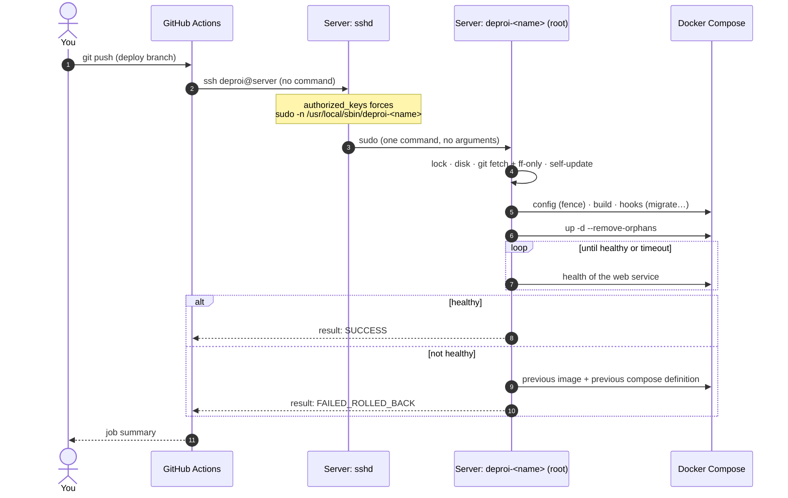
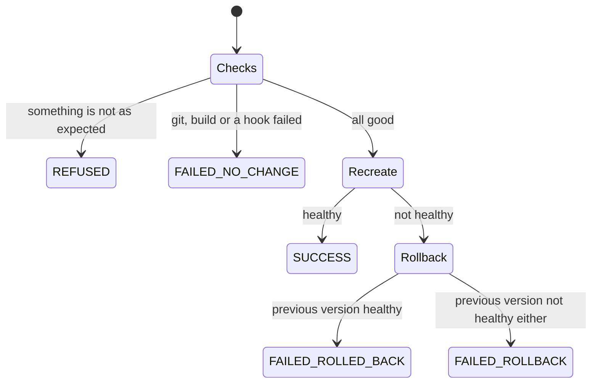

🇺🇸 English · [🇧🇷 Português](how-it-works.pt-BR.md)

# How it works

## The path of a deploy



The GitHub workflow is deliberately dumb: it writes the key to a temporary file, opens the SSH connection **without asking for any command**, prints what comes back, and writes a summary. All the logic lives on the server, in a root-owned file the repository cannot change at deploy time.

## The steps

Each step is a collapsible group in the Actions log, with its duration as the last line.

| # | Step | What happens | If it fails |
|---|---|---|---|
| 1 | **Lock** | One deploy per environment at a time (`flock`). A deploy waits up to `timeouts.lock`. | `REFUSED` — nothing changed |
| 2 | **Disk space** | At least `min_free_disk_gb` free for Docker. | `FAILED_NO_CHANGE` |
| 3 | **Update the code** | `git fetch` → the checkout must be on the branch, with no local changes to tracked files → the env file of the **fetched** commit must name this project → the remote must contain the local history → `git merge --ff-only`. Git runs as the checkout owner. | `REFUSED` or `FAILED_NO_CHANGE`; nothing changed |
| 4 | **Deploy script** | The `deproi.py` of the commit is compared with the running one. If it differs: test-load it, install it atomically, re-execute it (same lock). | `FAILED_NO_CHANGE`, installed script untouched |
| 5 | **Compose definition** | `docker compose config` of the new commit: every service has the environment suffix, the web service exists, built services are tagged `<image>:<commit>`. | `REFUSED` — nothing built |
| 6 | **Build** | `docker compose build`, low priority, tagged with the commit. | `FAILED_NO_CHANGE` |
| 7 | **Health check** | The web service must have one (compose `healthcheck:` or Dockerfile `HEALTHCHECK`). | `REFUSED` |
| 8 | **Dependencies** | Third-party services (database, cache) that are not running yet are started, and Deproi waits for them to be healthy. Running ones are left alone. | `FAILED_NO_CHANGE` |
| 8b | **Hooks** | `pre_migrate` → `migrate` → `post_migrate`, each on the new image. | per hook: `fail`, `refuse` or `warn` |
| 9 | **Protected services** | Busy workers are left on their version; idle ones may be quiesced. | — |
| 10 | **Recreate** | `docker compose up -d --remove-orphans`. When republishing the same commit, the project's own services are force-recreated (never third-party ones). Monitors get a grace period, if configured. | goes to rollback |
| 11 | **Health** | Waits until every web container is `healthy`, up to `timeouts.health`, or until Docker reports `unhealthy` three times in a row. | goes to rollback |
| 12 | **Rollback** | Only when 10 or 11 failed: the previous image **and the previous compose definition** come back, and health is checked again. | `FAILED_ROLLED_BACK` or `FAILED_ROLLBACK` |
| 13 | **Clean up** | Removes old images of this environment (never the current, the previous or one in use). | warning only |
| 14 | **Summary** | `betterstack:`, `cloudflare:`, `webhook:`, `post_deploy:`, then `message:` and `result:`. The post-deploy work detaches and runs in the background. | — |

## Outcomes



| Result | Exit | Meaning | What to do |
|---|---|---|---|
| `SUCCESS` | 0 | The new commit is live. | Nothing. |
| `SUCCESS_PROTECTED_DEFERRED` | 0 | Live, but a busy protected service stayed on the previous version. | Nothing: it updates on the next deploy. |
| `REFUSED` | 2 | Deproi found something unexpected (dirty checkout, wrong branch, fence, another deploy running…) and touched nothing. | Read the message, fix it, run again. |
| `FAILED_NO_CHANGE` | 3 | Something failed before any service was recreated (fetch, build, a hook). Migrations that ran stay applied. | Read the step's log, fix, push again. |
| `FAILED_ROLLED_BACK` | 4 | The new version was not healthy; the previous one is back and healthy. | Fix the code and push. Migrations were not undone. |
| `FAILED_ROLLBACK` | 5 | Not healthy, and the rollback did not recover either. **The environment is down.** | Follow plan B in [operations](operations.md#plan-b-deploy-by-hand). |

The last line is always machine-readable:

```text
result: SUCCESS commit=abc123def456 previous=111111111111 duration=94s protected=- step=cleanup script=up_to_date
```

## Self-update

The project keeps a copy of `deproi.py` (by default `deploy/deproi.py`). On every deploy, Deproi compares the copy in the commit with the code it is running:

- **Same:** carries on (`script=up_to_date`).
- **Different:** writes the new file next to the installed one, test-loads it in a separate Python (it must import cleanly and carry the `SELF_UPDATING = True` marker), renames it over `/usr/local/sbin/deproi-<name>` atomically, and re-executes itself with the new code, **keeping the lock**. The result line says `script=updated:<old>:<new>`.
- **Broken new version:** nothing is installed and nothing is deployed (`FAILED_NO_CHANGE`, `script=refused`). Fix it on the branch.

So upgrading Deproi in a project is just a commit. The optional `deproi-update.yml` workflow opens that commit as a pull request when a new release exists.

## When the SSH connection drops

The script ignores `SIGHUP` and writes through a pipe it controls, so a dropped connection (a laptop going to sleep, a network blip, a cancelled job) does not stop a deploy halfway. It finishes on its own and records the result in syslog: `journalctl -t deproi-<name>`.

## Design decisions

- **The workflow carries no logic.** Otherwise anyone who can change a YAML file could change what runs as root. The server decides; the workflow only knocks on the door.
- **One command per key, no arguments.** `restrict,command="…"` in `authorized_keys` plus a sudo rule ending in `""` means a leaked key can only trigger a deploy of the current branch, nothing else.
- **Config outside the repository.** Which branch, which project, which paths: decided by root on the server, not by a commit.
- **Fast-forward only.** The server never rewrites or discards history or files. Anything unexpected stops the deploy instead of being "fixed".
- **The previous compose definition comes back with the previous image.** A failure caused by the compose file (a wrong command, variable or probe) does not repeat during the rollback.
- **Integrations never decide.** Better Stack, Cloudflare or a webhook being down is a line in the summary, never a failed deploy.
- **Standard library only.** `deproi.py` runs on the server's own `python3` (3.10+), with nothing to install and nothing to keep updated.
