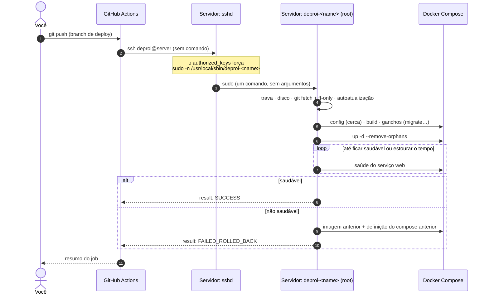
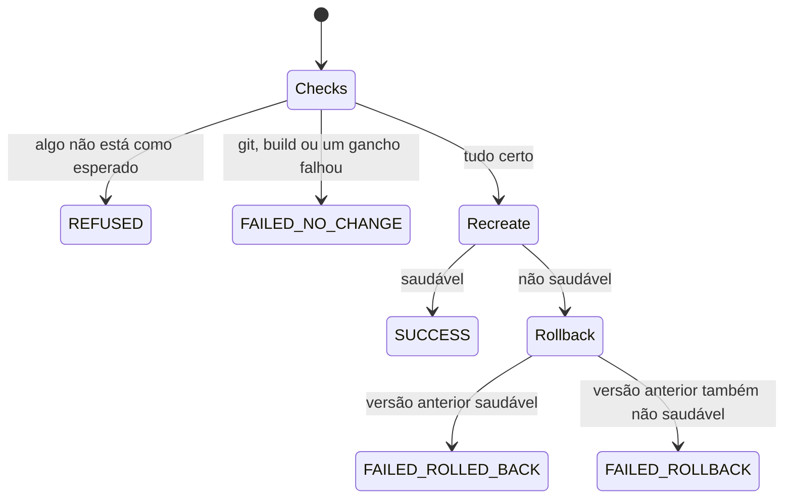

[🇺🇸 English](how-it-works.md) · 🇧🇷 Português

# Como funciona

## O caminho de um deploy



O workflow do GitHub é burro de propósito: ele grava a chave num arquivo temporário, abre a conexão SSH **sem pedir comando nenhum**, mostra o que volta e escreve um resumo. Toda a lógica mora no servidor, num arquivo com dono root que o repositório não consegue mudar na hora do deploy.

## Os passos

Cada passo é um grupo recolhível no log do Actions, com a duração na última linha.

| # | Passo | O que acontece | Se falhar |
|---|---|---|---|
| 1 | **Trava** | Um deploy por ambiente de cada vez (`flock`). Um deploy espera até `timeouts.lock`. | `REFUSED` — nada mudou |
| 2 | **Espaço em disco** | Pelo menos `min_free_disk_gb` livres para o Docker. | `FAILED_NO_CHANGE` |
| 3 | **Atualizar o código** | `git fetch` → o checkout precisa estar na branch, sem alteração local em arquivos rastreados → o arquivo env do commit **buscado** precisa apontar para este projeto → o remoto precisa conter o histórico local → `git merge --ff-only`. O git roda como o dono do checkout. | `REFUSED` ou `FAILED_NO_CHANGE`; nada mudou |
| 4 | **Script de deploy** | O `deproi.py` do commit é comparado com o que está rodando. Se for diferente: carrega como teste, instala de forma atômica e se reexecuta (mesma trava). | `FAILED_NO_CHANGE`, script instalado intocado |
| 5 | **Definição do Compose** | `docker compose config` do commit novo: todo serviço tem o sufixo do ambiente, o serviço web existe, os serviços construídos têm a tag `<image>:<commit>`. | `REFUSED` — nada foi construído |
| 6 | **Build** | `docker compose build`, com prioridade baixa, com a tag do commit. | `FAILED_NO_CHANGE` |
| 7 | **Healthcheck** | O serviço web precisa ter um (`healthcheck:` no compose ou `HEALTHCHECK` no Dockerfile). | `REFUSED` |
| 8 | **Dependências** | Os serviços de terceiros (banco de dados, cache) que ainda não estão rodando são iniciados, e o Deproi espera que fiquem saudáveis. Os que já estão rodando não são tocados. | `FAILED_NO_CHANGE` |
| 8b | **Ganchos** | `pre_migrate` → `migrate` → `post_migrate`, cada um na imagem nova. | por gancho: `fail`, `refuse` ou `warn` |
| 9 | **Serviços protegidos** | Workers ocupados ficam na versão deles; os livres podem ser pausados. | — |
| 10 | **Recriar** | `docker compose up -d --remove-orphans`. Ao republicar o mesmo commit, os serviços do próprio projeto são recriados à força (nunca os de terceiros). Os monitores ganham um período de tolerância, se configurado. | vai para a reversão |
| 11 | **Saúde** | Espera todo contêiner web ficar `healthy`, até `timeouts.health`, ou até o Docker informar `unhealthy` três vezes seguidas. | vai para a reversão |
| 12 | **Reversão** | Só quando o 10 ou o 11 falhou: a imagem anterior **e a definição do compose anterior** voltam, e a saúde é conferida de novo. | `FAILED_ROLLED_BACK` ou `FAILED_ROLLBACK` |
| 13 | **Limpeza** | Remove imagens antigas deste ambiente (nunca a atual, a anterior ou uma em uso). | só um aviso |
| 14 | **Resumo** | `betterstack:`, `cloudflare:`, `webhook:`, `post_deploy:`, depois `message:` e `result:`. O trabalho pós-deploy se desprende e roda em segundo plano. | — |

## Desfechos



| Resultado | Saída | Significado | O que fazer |
|---|---|---|---|
| `SUCCESS` | 0 | O commit novo está no ar. | Nada. |
| `SUCCESS_PROTECTED_DEFERRED` | 0 | No ar, mas um serviço protegido ocupado ficou na versão anterior. | Nada: ele atualiza no próximo deploy. |
| `REFUSED` | 2 | O Deproi encontrou algo inesperado (checkout sujo, branch errada, cerca, outro deploy rodando…) e não tocou em nada. | Leia a mensagem, corrija e rode de novo. |
| `FAILED_NO_CHANGE` | 3 | Algo falhou antes de qualquer serviço ser recriado (fetch, build, um gancho). Migrations que rodaram continuam aplicadas. | Leia o log do passo, corrija e faça push de novo. |
| `FAILED_ROLLED_BACK` | 4 | A versão nova não ficou saudável; a anterior voltou e está saudável. | Corrija o código e faça push. As migrations não foram desfeitas. |
| `FAILED_ROLLBACK` | 5 | Não ficou saudável, e a reversão também não recuperou. **O ambiente está fora do ar.** | Siga o plano B em [operação](operations.pt-BR.md#plano-b-deploy-à-mão). |

A última linha é sempre legível por máquina:

```text
result: SUCCESS commit=abc123def456 previous=111111111111 duration=94s protected=- step=cleanup script=up_to_date
```

## Autoatualização

O projeto guarda uma cópia do `deproi.py` (por padrão, `deploy/deproi.py`). A cada deploy, o Deproi compara a cópia do commit com o código que está rodando:

- **Igual:** segue em frente (`script=up_to_date`).
- **Diferente:** grava o arquivo novo ao lado do instalado, carrega-o como teste num Python separado (ele precisa importar sem erro e trazer a marca `SELF_UPDATING = True`), renomeia-o por cima de `/usr/local/sbin/deproi-<name>` de forma atômica e se reexecuta com o código novo, **mantendo a trava**. A linha de resultado diz `script=updated:<old>:<new>`.
- **Versão nova quebrada:** nada é instalado e nada vai para o ar (`FAILED_NO_CHANGE`, `script=refused`). Corrija na branch.

Então atualizar o Deproi num projeto é só um commit. O workflow opcional `deproi-update.yml` abre esse commit como pull request quando sai uma versão nova.

## Quando a conexão SSH cai

O script ignora o `SIGHUP` e escreve por um pipe que ele controla, então uma conexão que cai (um notebook que hiberna, uma oscilação de rede, um job cancelado) não interrompe o deploy no meio. Ele termina sozinho e registra o resultado no syslog: `journalctl -t deproi-<name>`.

## Decisões de projeto

- **O workflow não carrega lógica.** Senão, qualquer pessoa que consiga mudar um arquivo YAML mudaria o que roda como root. O servidor decide; o workflow só bate na porta.
- **Um comando por chave, sem argumentos.** `restrict,command="…"` no `authorized_keys`, mais uma regra do sudo terminada em `""`, faz com que uma chave vazada só consiga disparar o deploy da branch atual, e nada mais.
- **Configuração fora do repositório.** Qual branch, qual projeto, quais caminhos: quem decide é o root no servidor, não um commit.
- **Só fast-forward.** O servidor nunca reescreve nem descarta histórico ou arquivos. Qualquer coisa inesperada para o deploy em vez de ser "consertada".
- **A definição do compose anterior volta junto com a imagem anterior.** Uma falha causada pelo arquivo compose (um comando, uma variável ou uma sonda errados) não se repete durante a reversão.
- **Integrações nunca decidem.** Better Stack, Cloudflare ou um webhook fora do ar viram uma linha no resumo, nunca um deploy falho.
- **Só a biblioteca padrão.** O `deproi.py` roda no próprio `python3` do servidor (3.10+), sem nada para instalar e nada para manter atualizado.
