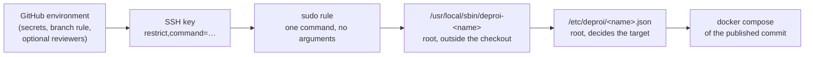

🇺🇸 English · [🇧🇷 Português](security.pt-BR.md)

# Security model

Deproi runs as root on your server, triggered from GitHub. This page says exactly what each party can and cannot do, so you can decide whether that fits your risk.

## The layers

| Layer | Guarantee |
|---|---|
| GitHub environment | The deploy secrets are only given to jobs running for the allowed branch. You can add required reviewers for production. |
| `authorized_keys` | `restrict` disables shells, pty, port/agent/X11 forwarding. `command=` ignores whatever the client asks and always runs the deploy. |
| sudo rule | The `deproi` user may run exactly `/usr/local/sbin/deproi-<name>`, and the trailing `""` forbids any argument. |
| Installed script | Owned by root, outside the checkout. Replaced only by the self-update, which takes the file from a commit already on the deploy branch. |
| Config | Owned by root, not writable by others; checked on every run. Unknown keys are refused. |
| Fences | Explicit `--project-name`; the env file must name the project; every service must carry the environment suffix; git only fast-forwards. |

## What each party can do

| If someone has… | They can | They cannot |
|---|---|---|
| **The deploy SSH key** | Trigger a deploy of what is already on the deploy branch (or a republish). | Open a shell, pass arguments or commands, forward ports, deploy another branch or another environment. |
| **Push access to the deploy branch** | Run code as root on that server — the commit's `compose.yaml`, Dockerfile and hooks run through Docker. **This is inherent to deploying containers.** | Change the target (branch, project, paths) or switch fences off — those live in the root-owned config. |
| **Write access to the workflow YAML** | Change what the runner does with the secrets it receives (if the branch rule lets that job run). | Change what runs on the server: the forced command decides. |
| **A shell as the `deproi` user** | Run the deploy. | Use Docker (not in the `docker` group), read the config or the secrets (root `0600`). |
| **Read access to the Actions logs** | See the deploy output. | See secrets: Compose's interpolated definition is never printed, tokens are redacted from every integration line. |

## Recommendations

1. **Protect the deploy branches** (branch protection or rulesets): require pull requests and passing checks. Push access to them is root on the server.
2. **Use GitHub environments** for the secrets (the setup script does this), with a branch rule. For production, add **required reviewers**.
3. **One key per environment.** Never reuse the test key for production. Rotate by running `create-deploy-key.sh` again.
4. **Keys only on SSH:** `PasswordAuthentication no`, and `fail2ban` on servers with SSH open to the internet.
5. **Never add `deproi` to the `docker` group.** That is root without sudo, and `doctor.sh` flags it.
6. **Secrets in root-only files** under `/etc/deproi`, never in the repository or in the JSON config.
7. **Check the host key fingerprint** when storing `DEPROI_KNOWN_HOSTS`, and keep `StrictHostKeyChecking=yes` (the workflow does).

## What Deproi records

Every run logs to syslog (`journalctl -t deproi-<name>`): when it started, from which SSH client, which command the client asked for (recorded, never executed), and the final `result:` line. Integration lines are redacted before they are logged.

## Reporting a vulnerability

See [SECURITY.md](../SECURITY.md). Please do not open public issues for vulnerabilities.
