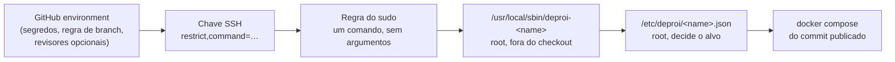

[🇺🇸 English](security.md) · 🇧🇷 Português

# Modelo de segurança

O Deproi roda como root no seu servidor, disparado a partir do GitHub. Esta página diz exatamente o que cada parte pode e não pode fazer, para você decidir se isso cabe no seu nível de risco.

## As camadas

| Camada | Garantia |
|---|---|
| GitHub environment | Os segredos do deploy só são entregues a jobs que rodam para a branch permitida. Dá para exigir revisores em produção. |
| `authorized_keys` | `restrict` desliga shell, pty e encaminhamento de porta, de agente e de X11. `command=` ignora o que o cliente pede e sempre roda o deploy. |
| Regra do sudo | O usuário `deproi` pode rodar exatamente `/usr/local/sbin/deproi-<name>`, e o `""` no final proíbe qualquer argumento. |
| Script instalado | Com dono root, fora do checkout. Só é substituído pela autoatualização, que pega o arquivo de um commit que já está na branch de deploy. |
| Configuração | Com dono root, sem permissão de escrita para outros; conferida a cada execução. Chaves desconhecidas são recusadas. |
| Cercas | `--project-name` explícito; o arquivo env precisa apontar para o projeto; todo serviço precisa ter o sufixo do ambiente; o git só avança por fast-forward. |

## O que cada parte pode fazer

| Se alguém tem… | Consegue | Não consegue |
|---|---|---|
| **A chave SSH de deploy** | Disparar o deploy do que já está na branch de deploy (ou uma republicação). | Abrir um shell, passar argumentos ou comandos, encaminhar portas, fazer deploy de outra branch ou de outro ambiente. |
| **Permissão de push na branch de deploy** | Rodar código como root naquele servidor — o `compose.yaml`, o Dockerfile e os ganchos do commit rodam pelo Docker. **Isso é inerente a fazer deploy de contêineres.** | Mudar o alvo (branch, projeto, caminhos) ou desligar as cercas — isso mora na configuração com dono root. |
| **Permissão de escrita no YAML do workflow** | Mudar o que o runner faz com os segredos que recebe (se a regra de branch deixar esse job rodar). | Mudar o que roda no servidor: quem decide é o comando forçado. |
| **Um shell como o usuário `deproi`** | Rodar o deploy. | Usar o Docker (não está no grupo `docker`), ler a configuração ou os segredos (root `0600`). |
| **Acesso de leitura aos logs do Actions** | Ver a saída do deploy. | Ver segredos: a definição interpolada do Compose nunca é impressa, e os tokens são ocultados em toda linha de integração. |

## Recomendações

1. **Proteja as branches de deploy** (branch protection ou rulesets): exija pull requests e checagens aprovadas. Permissão de push nelas equivale a root no servidor.
2. **Use GitHub environments** para os segredos (o script de configuração faz isso), com uma regra de branch. Em produção, adicione **revisores obrigatórios**.
3. **Uma chave por ambiente.** Nunca reaproveite a chave de teste em produção. Para fazer a rotação, rode `create-deploy-key.sh` de novo.
4. **SSH só com chave:** `PasswordAuthentication no`, e `fail2ban` em servidores com SSH aberto para a internet.
5. **Nunca coloque o `deproi` no grupo `docker`.** Isso é root sem sudo, e o `doctor.sh` aponta o problema.
6. **Segredos em arquivos só do root** em `/etc/deproi`, nunca no repositório nem na configuração JSON.
7. **Confira a impressão digital da chave do host** ao guardar o `DEPROI_KNOWN_HOSTS`, e mantenha `StrictHostKeyChecking=yes` (o workflow mantém).

## O que o Deproi registra

Toda execução registra no syslog (`journalctl -t deproi-<name>`): quando começou, de qual cliente SSH, qual comando o cliente pediu (registrado, nunca executado) e a linha final `result:`. As linhas de integração são ocultadas antes de ir para o log.

## Como relatar uma vulnerabilidade

Veja o [SECURITY.pt-BR.md](../SECURITY.pt-BR.md). Por favor, não abra issues públicas para vulnerabilidades.
